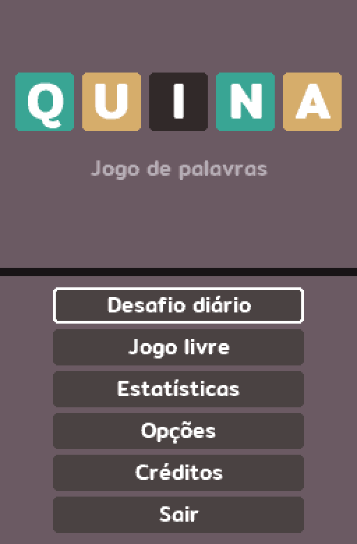
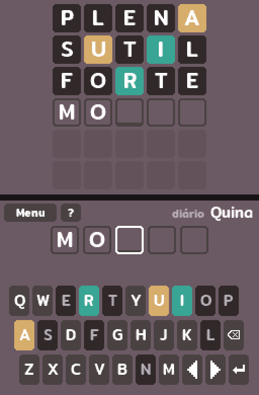
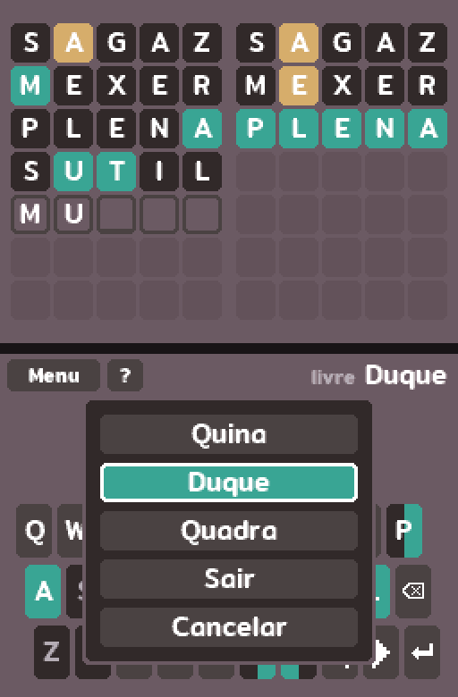
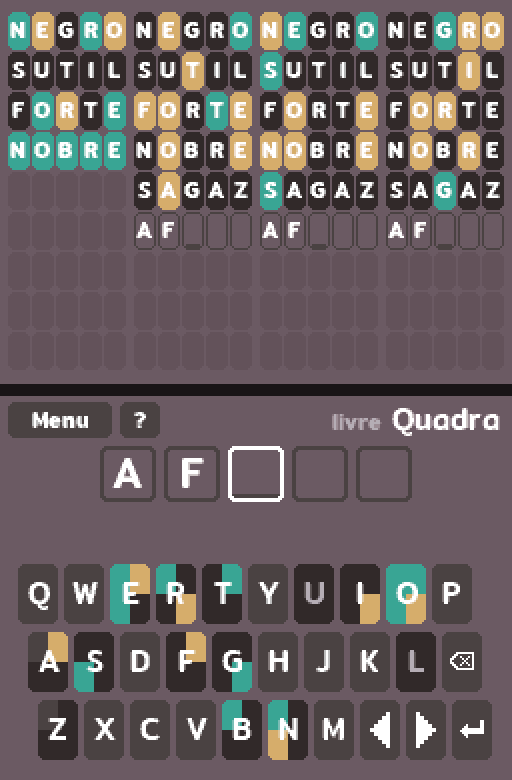
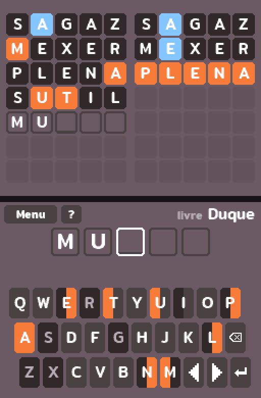
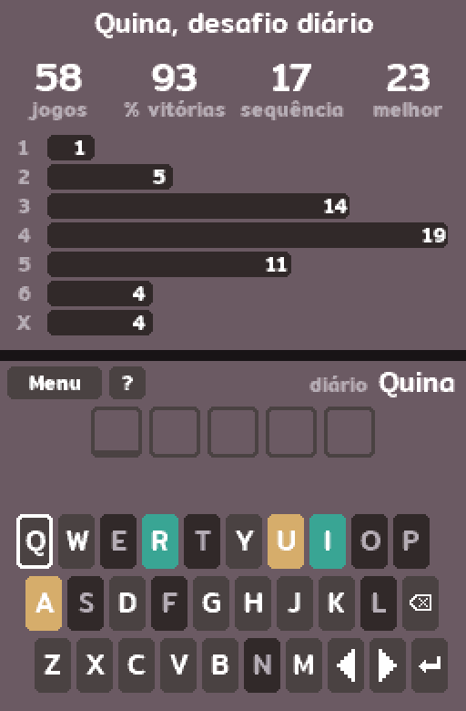

# Quina

[Leia em português](README.pt-BR.md)

A word guessing game for the Nintendo DS. Guess the five-letter Portuguese
word, or play two or four words at once.

Inspirado em Termo (term.ooo), de Fernando Serboncini.

Quina is an unofficial homebrew project and is not affiliated with or endorsed
by Nintendo. Nintendo DS is a trademark of Nintendo.

<table>
  <tr>
    <td></td>
    <td></td>
    <td></td>
  </tr>
  <tr>
    <td></td>
    <td></td>
    <td></td>
  </tr>
</table>

## Modes

- **Quina**: one word, 6 guesses.
- **Duque**: two words at once, 7 guesses.
- **Quadra**: four words at once, 9 guesses.

Every mode has a **daily challenge**, the same for everyone on the same day
and playable once, and **free play** with as many games as you like. Each has
its own stats.

After each guess, the tiles show how close it was:

- green: the letter is in the word, in that spot;
- yellow: the letter is in the word, in another spot;
- dark: the letter isn't in the word (or not as many times).

Accents don't need to be typed: they're filled in when the guess is revealed.

The options have a high contrast mode, with orange and blue instead of green
and yellow, and a hard mode, where every hint revealed must be used in the
next guesses.

## Controls

| Input | Action |
| --- | --- |
| Stylus | Type, pick a letter box to change it, use the buttons |
| D-pad | Move around the keyboard, or between the letter boxes after touching the screen |
| A | Press the highlighted key |
| B / L | Erase |
| R | Send the guess |
| SELECT | Show or hide the stats |
| Y or ? | Show or hide how to play |
| X | Open the menu (switch modes or quit) |
| START | Daily: open the menu. Free play: start a new game |

## Playing on a console

Copy `quina.nds` to the SD card and open it from the menu of your loader. The
game saves to `/data/quina/save.dat` on the SD card. Without an SD card it
still runs, it just can't save.

- **DS / DS Lite**: use a flashcart. Most of them patch the ROM for SD access
  on their own.
- **DSi**: open it from [TWiLight Menu++](https://wiki.ds-homebrew.com/twilightmenu/)
  or another homebrew loader with SD access.
- **3DS**: open it from [TWiLight Menu++](https://wiki.ds-homebrew.com/twilightmenu/).

The daily challenge follows the console's clock, so check the date and time in
the system settings.

## Building

You need [BlocksDS](https://blocksds.skylyrac.net/) and Python 3. On Linux:

    sudo mkdir -p /opt/wonderful && sudo chown $USER /opt/wonderful
    curl -L https://wonderful.asie.pl/bootstrap/wf-bootstrap-x86_64.tar.gz | tar xz -C /opt/wonderful
    export PATH=/opt/wonderful/bin:$PATH
    wf-pacman -Syu
    wf-pacman -S wf-tools
    wf-config repo enable blocksds
    wf-pacman -Syu
    wf-pacman -S blocksds-toolchain
    export BLOCKSDS=/opt/wonderful/thirdparty/blocksds/core

For other systems, follow the
[BlocksDS setup guide](https://blocksds.skylyrac.net/docs/setup/).

Then:

    make        # builds quina.nds
    make test   # runs the game logic tests on the PC

### Word lists

`data/answers.txt` has the words that can be answers and `data/allowed.txt`
the other words accepted as guesses, one per line in UTF-8, with accents. The
build turns them into compact tables, and stops with the file and line of any
word that isn't five letters.

The lists are built by `tools/build_wordlists.py` from the lexicon, conjugations
and word frequencies in [fserb/pt-br](https://github.com/fserb/pt-br). Answers are
the most common lexicon words, minus plurals, offensive words and the ones in
`tools/answer_exclusions.txt`, which were reviewed by hand.

The order of the daily challenges comes from the answer list, so changing it
changes which word falls on each day.

### Font

The text uses the Mitr font, already converted into `source/font_data.c`. To
convert it again, get the TTF files from
[Google Fonts](https://fonts.google.com/specimen/Mitr), install Pillow and run:

    python3 tools/font.py source/font_data.c Mitr-SemiBold.ttf:11 Mitr-Medium.ttf:15 \
        Mitr-Medium.ttf:21 Mitr-SemiBold.ttf:36

## Credits

Made by Coimbrice.

This project had help from Claude with code, review and organization.

Music: "Gem Waltz" composition and arrangement by Haley Halcyon, from
[OpenGameArt](https://opengameart.org/content/gem-waltz-free-music-loop),
licensed under [CC-BY 4.0](https://creativecommons.org/licenses/by/4.0/).
Converted to mono at 16 kHz for the DS.

Sound effects: [Interface Sounds](https://kenney.nl/assets/interface-sounds) by
Kenney, released under CC0.

The game uses the [Mitr](https://github.com/cadsondemak/mitr) font by Cadson
Demak, licensed under the SIL Open Font License (see `OFL.txt`).

## License

The code is under the MIT License (see `LICENSE`). The word lists in `data/` are
derived from [fserb/pt-br](https://github.com/fserb/pt-br) by Fernando
Serboncini, also under the MIT License (see `data/LICENSE`). The Mitr font is under the SIL Open Font License (see `OFL.txt`).
