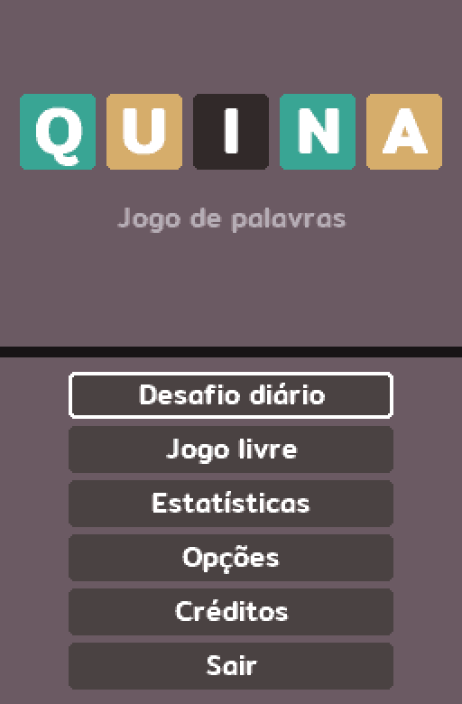
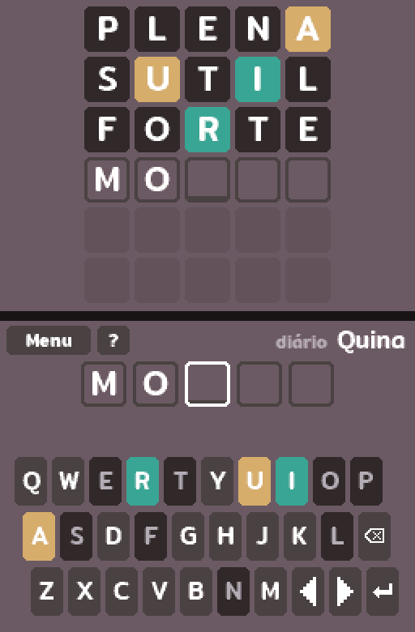
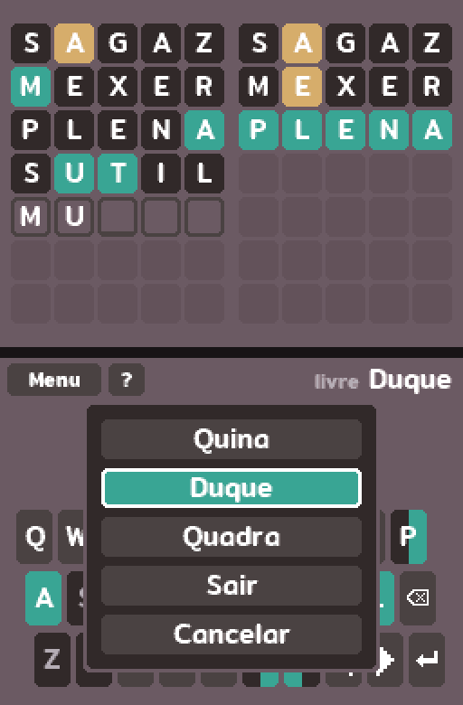
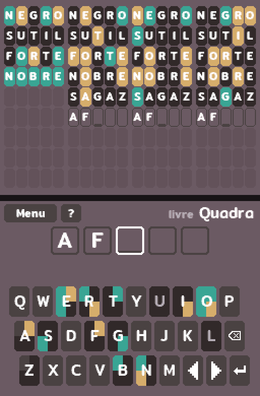
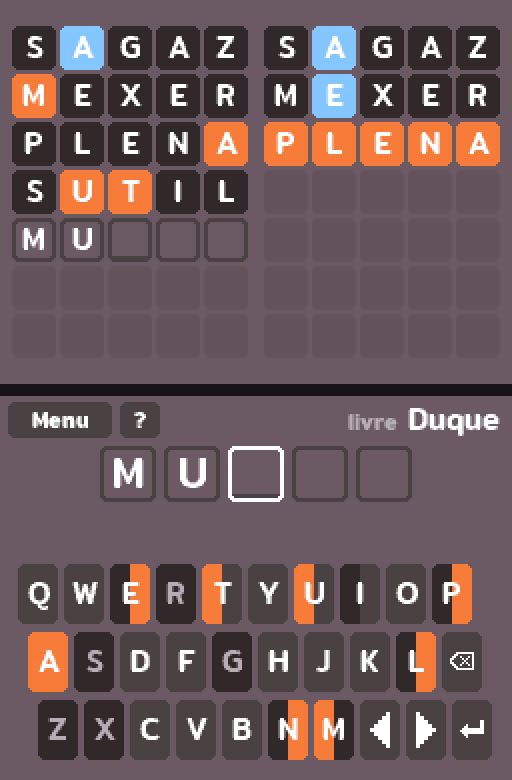
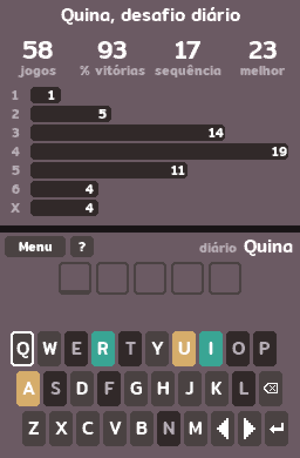

# Quina

[Read in English](README.md)

Um jogo de adivinhar palavras para Nintendo DS. Descubra a palavra de cinco
letras, ou jogue com duas ou quatro palavras ao mesmo tempo.

Inspirado em Termo (term.ooo), de Fernando Serboncini.

Quina é um projeto homebrew não oficial, sem afiliação com a Nintendo e sem
aprovação dela. Nintendo DS é uma marca registrada da Nintendo.

<table>
  <tr>
    <td></td>
    <td></td>
    <td></td>
  </tr>
  <tr>
    <td></td>
    <td></td>
    <td></td>
  </tr>
</table>

## Modos

- **Quina**: uma palavra, 6 tentativas.
- **Duque**: duas palavras ao mesmo tempo, 7 tentativas.
- **Quadra**: quatro palavras ao mesmo tempo, 9 tentativas.

Cada modo tem um **desafio diário**, igual para todo mundo no mesmo dia e que
só pode ser jogado uma vez, e o **jogo livre**, com quantas partidas você
quiser. Cada um tem as próprias estatísticas.

Depois de cada chute, os tiles mostram o quanto você chegou perto:

- verde: a letra está na palavra, nessa posição;
- amarelo: a letra está na palavra, em outra posição;
- escuro: a letra não está na palavra (ou não tantas vezes).

Não precisa digitar acentos: eles aparecem quando o chute é revelado.

Nas opções há o modo de alto contraste, com laranja e azul no lugar de verde e
amarelo, e o modo difícil, em que toda dica revelada tem que ser usada nos
chutes seguintes.

## Controles

| Entrada | Ação |
| --- | --- |
| Caneta | Digitar, escolher uma casa para trocar a letra, usar os botões |
| Direcional | Andar pelo teclado, ou pelas casas depois de tocar na tela |
| A | Apertar a tecla destacada |
| B / L | Apagar |
| R | Enviar o chute |
| SELECT | Mostrar ou esconder as estatísticas |
| Y ou ? | Mostrar ou esconder como jogar |
| X | Abrir o menu (trocar de modo ou sair) |
| START | Diário: abrir o menu. Jogo livre: começar outra partida |

## Jogando no console

Copie o `quina.nds` para o cartão SD e abra pelo menu do seu loader. O jogo
salva em `/data/quina/save.dat` no cartão SD. Sem cartão SD ele funciona do
mesmo jeito, só não salva.

- **DS / DS Lite**: use um flashcart. A maioria já ajusta a ROM para acessar
  o SD sozinha.
- **DSi**: abra pelo [TWiLight Menu++](https://wiki.ds-homebrew.com/twilightmenu/)
  ou outro loader de homebrew com acesso ao SD.
- **3DS**: abra pelo [TWiLight Menu++](https://wiki.ds-homebrew.com/twilightmenu/).

O desafio diário segue o relógio do console, então confira a data e a hora
nas configurações do sistema.

## Compilando

Você precisa do [BlocksDS](https://blocksds.skylyrac.net/) e do Python 3. No
Linux:

    sudo mkdir -p /opt/wonderful && sudo chown $USER /opt/wonderful
    curl -L https://wonderful.asie.pl/bootstrap/wf-bootstrap-x86_64.tar.gz | tar xz -C /opt/wonderful
    export PATH=/opt/wonderful/bin:$PATH
    wf-pacman -Syu
    wf-pacman -S wf-tools
    wf-config repo enable blocksds
    wf-pacman -Syu
    wf-pacman -S blocksds-toolchain
    export BLOCKSDS=/opt/wonderful/thirdparty/blocksds/core

Em outros sistemas, siga o
[guia de instalação do BlocksDS](https://blocksds.skylyrac.net/docs/setup/).

Depois:

    make        # gera o quina.nds
    make test   # roda os testes da lógica do jogo no PC

### Listas de palavras

`data/answers.txt` tem as palavras que podem ser resposta e `data/allowed.txt`
as outras palavras aceitas como chute, uma por linha em UTF-8, com acentos. O
build transforma as listas em tabelas compactas e para, indicando arquivo e
linha, se alguma palavra não tiver cinco letras.

As listas são geradas por `tools/build_wordlists.py` a partir do léxico, das
conjugações e das frequências de uso em
[fserb/pt-br](https://github.com/fserb/pt-br). As respostas são as palavras mais
comuns do léxico, menos plurais, palavras ofensivas e as que estão em
`tools/answer_exclusions.txt`, revisadas à mão.

A ordem dos desafios diários vem da lista de respostas, então mudar a lista
muda a palavra de cada dia.

### Fonte

O texto usa a fonte Mitr, já convertida em `source/font_data.c`. Para
converter de novo, baixe os arquivos TTF no
[Google Fonts](https://fonts.google.com/specimen/Mitr), instale o Pillow e
rode:

    python3 tools/font.py source/font_data.c Mitr-SemiBold.ttf:11 Mitr-Medium.ttf:15 \
        Mitr-Medium.ttf:21 Mitr-SemiBold.ttf:36

## Créditos

Feito por Coimbrice.

Este projeto teve auxílio do Claude no código, na revisão e na organização.

Música: "Gem Waltz", composição e arranjo de Haley Halcyon, do
[OpenGameArt](https://opengameart.org/content/gem-waltz-free-music-loop), sob
a licença [CC-BY 4.0](https://creativecommons.org/licenses/by/4.0/).
Convertida para mono em 16 kHz para o DS.

Efeitos sonoros: [Interface Sounds](https://kenney.nl/assets/interface-sounds),
de Kenney, em CC0.

O jogo usa a fonte [Mitr](https://github.com/cadsondemak/mitr), da Cadson
Demak, sob a SIL Open Font License (veja `OFL.txt`).

## Licença

O código está sob a licença MIT (veja `LICENSE`). As listas de palavras em
`data/` derivam de [fserb/pt-br](https://github.com/fserb/pt-br), de Fernando
Serboncini, também sob a licença MIT (veja `data/LICENSE`). A fonte Mitr está sob a SIL Open Font License (veja `OFL.txt`).
